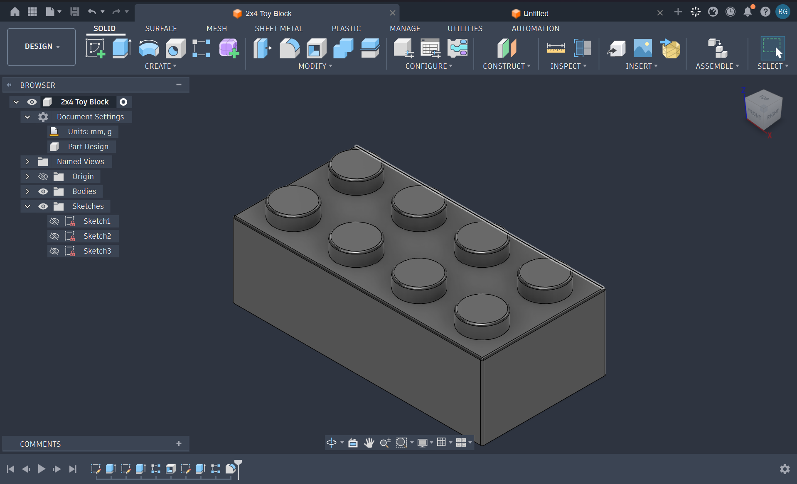

# TUT-01 — 2×4 Toy Block

## Overview

This is my first documented CAD model created using Autodesk Fusion 360. The design is a 2×4 toy building block with eight cylindrical studs.

I created this model while following a beginner tutorial to become more familiar with Fusion 360 and understand how simple sketches can be developed into three-dimensional objects.

## Design Information

| Property | Details |
|---|---|
| Design ID | TUT-0001 |
| Software | Autodesk Fusion 360 |
| Category | Tutorial / Learning |
| Model | 2×4 Toy Block |
| Status | Completed |

## Skills Practiced

- Creating and modifying 2D sketches
- Working with geometric dimensions
- Extruding sketches into 3D solids
- Creating repeated geometric features
- Applying fillets to edges
- Understanding the Fusion 360 design timeline

## Design Files

| File | Description |
|---|---|
| [2x4-Toy-Block.f3d](2x4-Toy-Block.f3d) | Editable Fusion 360 design |
| [preview.png](preview.png) | Preview of the completed model |

## Tutorial Reference

This model was created as part of my CAD learning process by following a Fusion 360 tutorial.

**Tutorial:** [Watch on YouTube](https://www.youtube.com/watch?v=4G2E_DqQteM)

The original tutorial and its instructional content belong to their respective creator.

---

*Part of my ongoing CAD Engineering Portfolio, documenting my progress in 3D modeling, mechanical design, and digital fabrication.*
