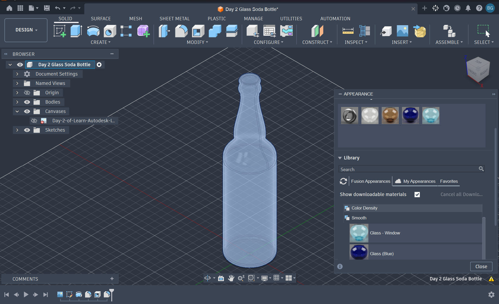

# TUT-02 — Glass Soda Bottle

## Overview

This project explores reverse modeling in Autodesk Fusion 360 by recreating a glass soda bottle from a reference image.

The main objective was to understand how a two-dimensional profile can be transformed into a three-dimensional object using the Revolve tool.

## Skills Practiced

- Importing and positioning reference images using Canvas
- Tracing object profiles using sketches
- Understanding rotational symmetry
- Creating 3D geometry using Revolve
- Applying transparent glass appearances

## Design Files

| File | Description |
|---|---|
| `Glass-Soda-Bottle.f3d` | Editable Fusion 360 model |
| `preview.png` | Preview of the completed design |

## Tutorial Reference

Created as part of my Fusion 360 learning process.

[Tutorial on YouTube](https://www.youtube.com/watch?v=_x2Q44UTyrA)

*This model is a tutorial-based learning exercise, not an independently developed product design.*
