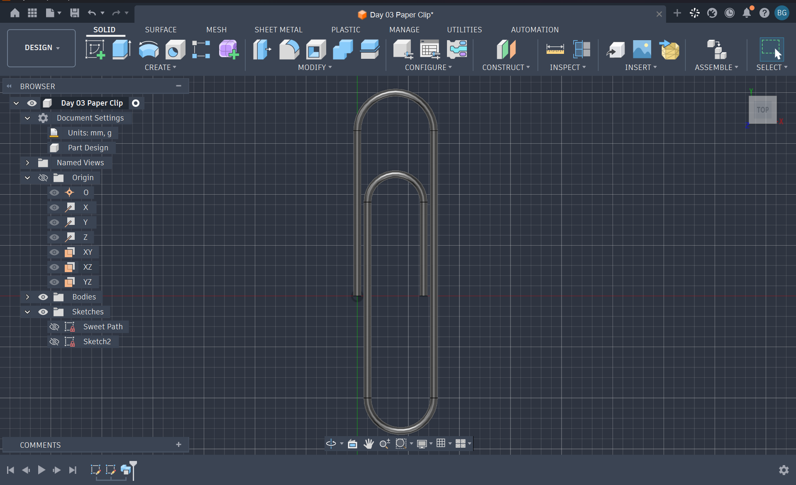

# TUT-0003 — Paper Clip

## Overview

A 3D model of a paper clip created in Autodesk Fusion 360 as part of my CAD learning process.

This exercise focused on using the **Sweep tool** to create a solid object by moving a circular profile along a predefined sketch path.

## Design Information

| Property | Details |
|---|---|
| Design ID | TUT-0003 |
| Software | Autodesk Fusion 360 |
| Category | Learning & Tutorials |
| Main Feature | Sweep |
| Status | Completed |

## Skills Practiced

- Creating and editing 2D sketch paths
- Working with lines and arcs
- Creating circular profiles
- Using the Sweep tool to generate 3D geometry
- Understanding how profiles follow sketch paths

## Design Files

| File | Description |
|---|---|
| [Paper-Clip.f3d](Paper-Clip.f3d) | Editable Fusion 360 model |
| [preview.png](preview.png) | Preview of the completed design |

## Tutorial Reference

Created while following a Fusion 360 tutorial.

[Watch the tutorial on YouTube](https://www.youtube.com/watch?v=JG5Z4ZJmkmE)

*This is a tutorial-based learning exercise.*
