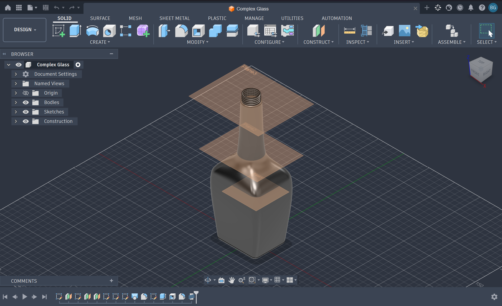

# TUT-0004 — Complex Glass Bottle

## Overview

A CAD model of a glass bottle created in Autodesk Fusion 360 as part of my ongoing CAD learning process.

The design features a rectangular lower body with rounded transitions, a tapered neck, and a threaded opening. This exercise introduced more complex geometry and the use of construction planes to develop different sections of a model.

## Design Information

| Property | Details |
|---|---|
| Design ID | TUT-0004 |
| Software | Autodesk Fusion 360 |
| Category | Learning & Tutorials |
| Model | Complex Glass Bottle |
| Status | Completed |

## Skills Practiced

- Creating sketches on different planes
- Using construction planes to position profiles
- Developing transitions between different cross-sectional shapes
- Modeling curved surfaces and rounded transitions
- Creating threaded cylindrical features
- Working with more complex solid geometry

## Design Files

| File | Description |
|---|---|
| [Complex-Glass-Bottle.f3d](Complex-Glass-Bottle.f3d) | Editable Fusion 360 model |
| [preview.png](preview.png) | Preview of the completed design |

## Tutorial Reference

Created while following a Fusion 360 modeling tutorial.

[Watch the tutorial on YouTube](https://www.youtube.com/watch?v=rcD7wcNFwsU&t=384s)

*This is a tutorial-based CAD learning exercise.*
