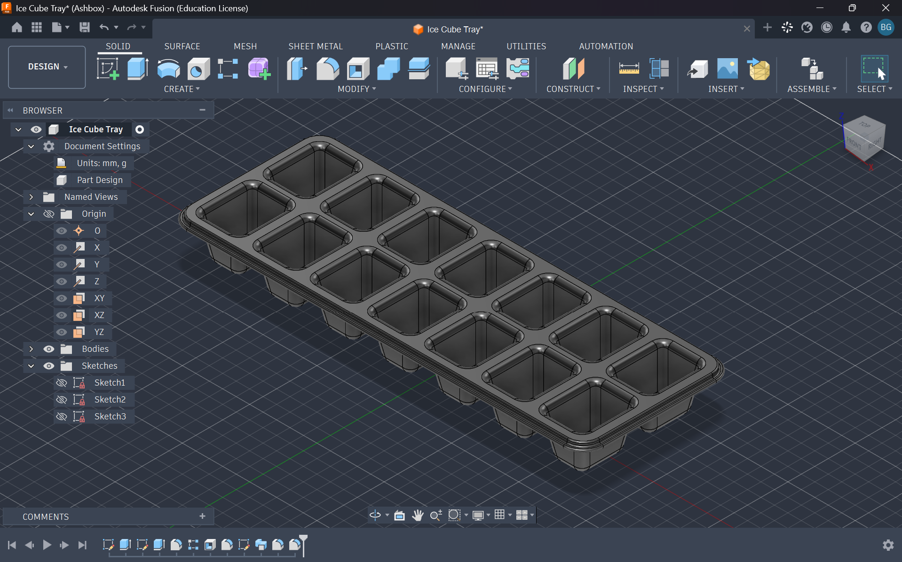

# TUT-05 — Ice Cube Tray

## Overview

A compartment tray modeled in Autodesk Fusion 360 as part of my CAD learning process.

This exercise focused on creating repeated geometric features, linking dimensions, and developing thin-walled geometry using parametric modeling techniques.

## Design Information

| Property | Details |
|---|---|
| Design ID | TUT-05 |
| Software | Autodesk Fusion 360 |
| Category | Learning & Tutorials |
| Main Features | Rectangular Pattern, Shell |

## Skills Practiced

- Linking sketch dimensions using expressions
- Creating tapered extrusions
- Using rectangular feature patterns
- Applying internal fillets
- Hollowing geometry using the Shell tool
- Understanding pattern computation methods

## Design Files

| File | Description |
|---|---|
| [Compartment-Tray.f3d](Compartment-Tray.f3d) | Editable Fusion 360 model |
| [preview.png](preview.png) | Preview of the completed design |

## Tutorial Reference

[Day 5 — Learn Autodesk Fusion in 30 Days](https://www.youtube.com/watch?v=I6BooYAo1mg) by Kevin Kennedy, Product Design Online.

*This is a tutorial-based CAD learning exercise.*
