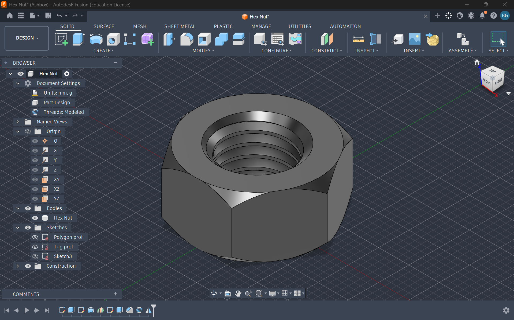

# TUT-06 — Hex Nut

## Overview

A hexagonal nut modeled in Autodesk Fusion 360 as part of my CAD learning process.

This exercise focused on modeling a common mechanical fastener and understanding the geometry of threaded components.

## Design Information

| Property | Details |
|---|---|
| Design ID | TUT-06 |
| Software | Autodesk Fusion 360 |
| Category | Learning & Tutorials |
| Model | Hex Nut |

## Skills Practiced

- Creating hexagonal sketches
- Applying dimensions and constraints
- Extruding mechanical geometry
- Creating cylindrical holes
- Working with threads and chamfers

## Design Files

| File | Description |
|---|---|
| [Hex-Nut.f3d](Hex-Nut.f3d) | Editable Fusion 360 model |
| [preview.png](preview.png) | Preview of the completed design |

## Tutorial Reference

[Day 6 — Learn Autodesk Fusion in 30 Days](https://www.youtube.com/watch?v=n854QDOAVqg)

*This is a tutorial-based CAD learning exercise.*
