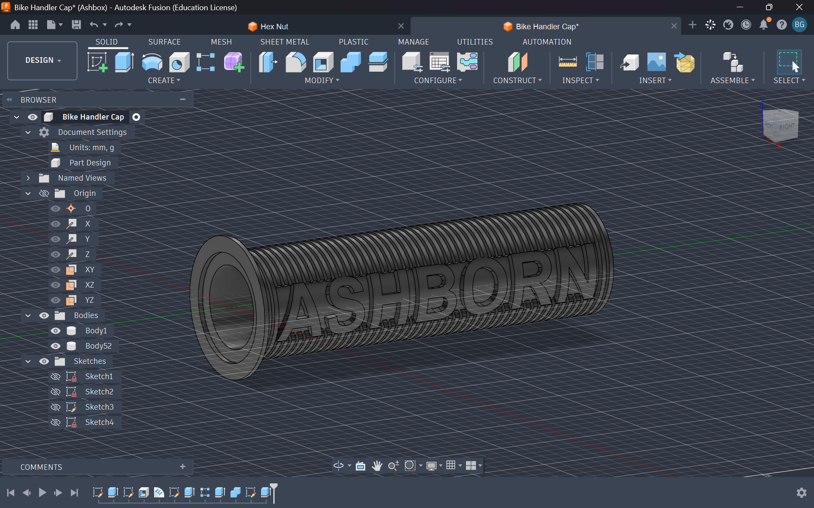

# TUT-07 — Bike Handlebar Grip

## Overview

A bicycle handlebar grip modeled in Autodesk Fusion 360, featuring raised text and a repeated grip texture.

This exercise focused on referencing existing geometry, applying text to curved surfaces, and creating parametric features that adapt to dimensional changes.

## Design Information

| Property | Details |
|---|---|
| Design ID | TUT-07 |
| Software | Autodesk Fusion 360 |
| Category | Learning & Tutorials |
| Main Features | Emboss, Project, Offset |

## Skills Practiced

- Creating and constraining sketch text
- Using Emboss and Deboss on curved surfaces
- Referencing geometry using Project and Intersect
- Creating offset sketch profiles
- Applying rectangular body patterns
- Using Shell and Combine
- Editing and managing the parametric timeline
- Applying material appearances

## Design Files

| File | Description |
|---|---|
| [Bike-Handlebar-Grip.f3d](Bike-Handlebar-Grip.f3d) | Editable Fusion 360 model |
| [preview.png](preview.png) | Preview of the completed design |

## Tutorial Reference

[Day 7 — Learn Autodesk Fusion in 30 Days](https://www.youtube.com/watch?v=iiXxXSkGXI4) by Kevin Kennedy, Product Design Online.

*This is a tutorial-based CAD learning exercise.*
